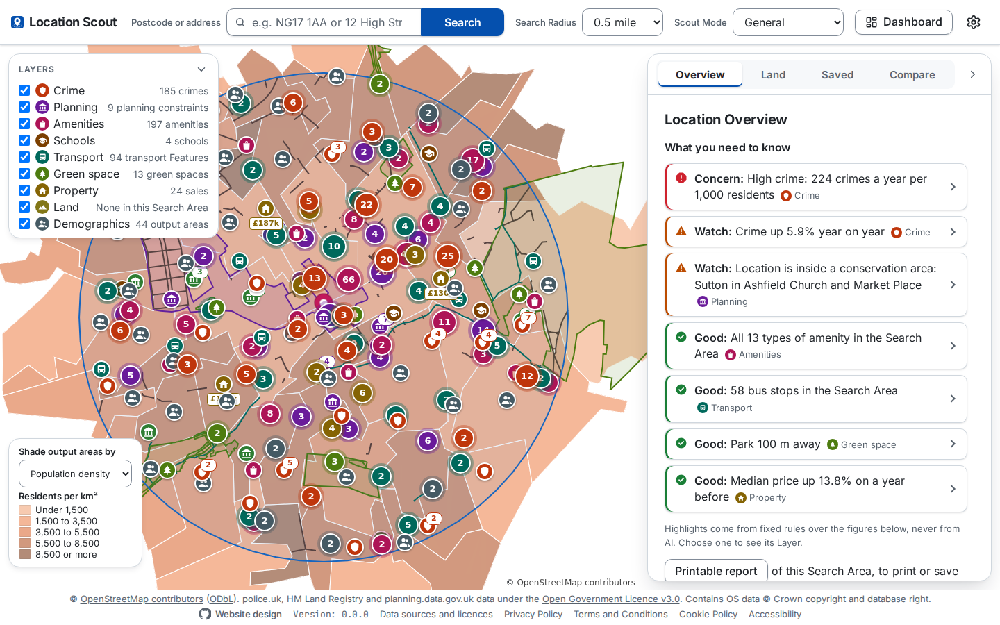
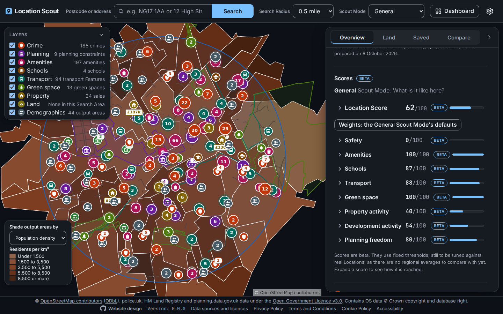
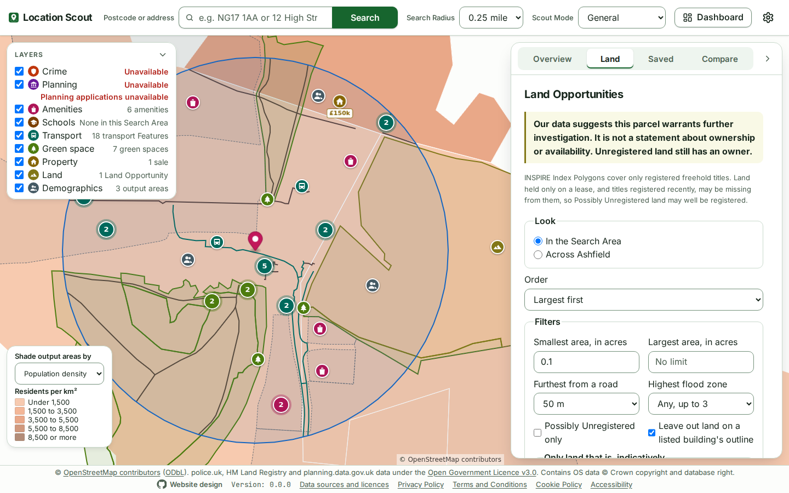
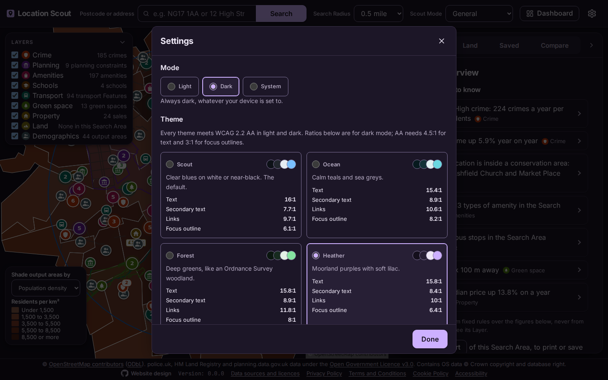
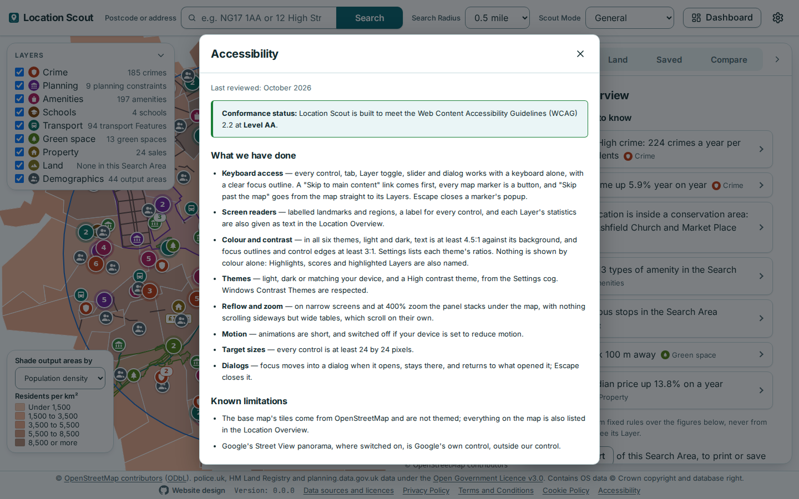
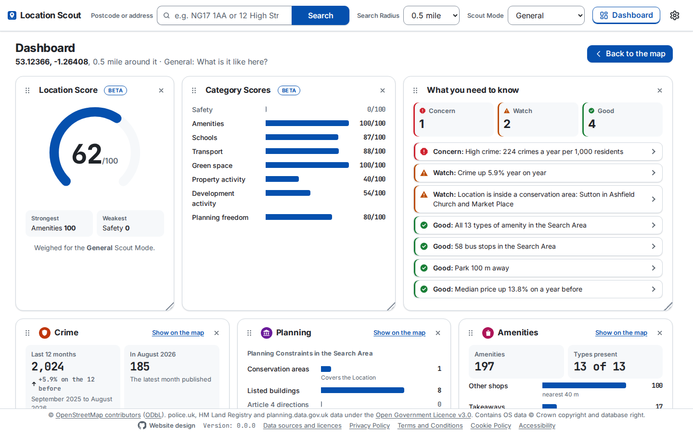
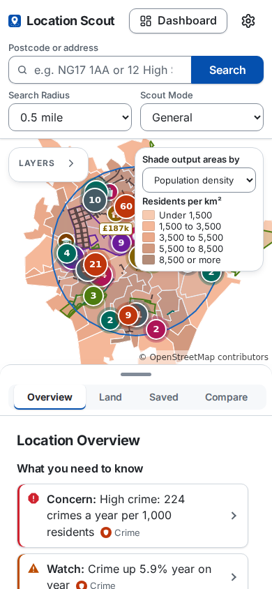

# Location Scout

Pick any location in England (a postcode, an address or a click on the map) and see everything around it on one screen:

- **Interactive map** with layers for crime (with year-on-year trend), planning (constraints, plus applications with estimated new homes), amenities, schools (with Ofsted ratings), transport, green space, property (sale history, price change, EPC), land and demographics.
- **Location Overview:** "what you need to know" Highlights (Good / Watch / Concern), headline statistics, local geography, and transparent 0–100 scores, each with a visible breakdown.
- **Scout Modes:** General, Homebuyer, Buy-to-let, Investment, Development, Retail, and Business (café, restaurant, takeaway, gym, hairdresser, convenience store, dental practice, nursery). Each reweights the scores for one purpose.
- **Land Opportunity Finder:** open land worth investigating, with indicative ownership (company, council, other registered, possibly unregistered) and nearby land sales.
- **Optional Google Street View** with your own key.
- **Dashboard:** every figure drawn at full width: the Location Score in an arc, Category Scores, Highlights by level, and a card of charts for each Layer, the Scout Mode's first.
- **Saved Locations, side-by-side comparison and printable reports.**
- **Optional AI Explanations** of the calculated scores, using your own Anthropic API key.
- **Light, dark or system mode and six colour themes**, built to meet WCAG 2.2 AA.

> **Status:** Phase 1 is being built and runs locally.

**Website:** [location-scout.adrianeyre.co.uk](https://location-scout.adrianeyre.co.uk), built from `site/` by `pnpm site:build` and published to GitHub Pages.

<p align="center">
  
</p>

## Screenshots

| | |
|---|---|
|  |  |
| **Scores**, in dark mode | **Land Opportunity Finder**, in the Forest theme |
|  |  |
| **Settings**: light, dark or system mode and six themes | **Policies** open in dialogs from the footer |

<p align="center">
  
</p>

<p align="center">
  
</p>

The screenshots come from the fixture-backed app, so the map's tiles are blank; `README_SCREENSHOTS=1 pnpm --filter @location-scout/web test:e2e readme-screenshots --project=chromium` takes them again.

## Quick start

```bash
pnpm install
cp .env.example .env   # then set NOMINATIM_USER_AGENT
pnpm dev                                 # http://localhost:5173
```

[Getting started](docs/guides/getting-started.md) has the details, and [Preparing land data](docs/guides/preparing-land-data.md) the optional Land Opportunity data.

To check that every live Data Source still answers as the app expects, run `pnpm smoke`. It is opt-in and never runs in CI: it calls each one once, with your settings from `.env`, and reports pass, fail, or skipped where a key isn't set ([Smoke script](docs/guides/testing.md#smoke-script)).

To measure the PRD's performance targets (NFR-2.1 to NFR-2.5) on your machine, run `pnpm bench`. It loads NG17 1AA's Search Area through the API as the frontend does, uncached and then cached, searches for Land Opportunities across Ashfield, and with `--prepare` times `pnpm data:prepare`, reporting pass, fail or skipped for each ([Benchmark](docs/guides/testing.md#benchmark)). It is opt-in too, and never runs in CI.

## Guides

| Guide | What it covers |
|---|---|
| [Getting started](docs/guides/getting-started.md) | Prerequisites, install, configure and run; searching and the URL |
| [Preparing land data](docs/guides/preparing-land-data.md) | `pnpm data:prepare`: what it downloads and where it puts it |
| [Layers and Street View](docs/guides/layers-and-street-view.md) | Every Layer, its Data Source and statistics, and the optional Street View panel |
| [Scores, Highlights and Scout Modes](docs/guides/scores-highlights-and-scout-modes.md) | Category Scores, the Location Score, Highlights, Scout Modes and weights of your own |
| [The Dashboard](docs/guides/dashboard.md) | The full-width view of every figure: what each card shows, and how its charts are drawn and kept accessible |
| [Saved Locations, comparing and the printable report](docs/guides/saved-locations-compare-and-report.md) | Saved Locations in the browser, import and export, comparing 2 to 4 side by side, and the printable report |
| [AI Explanations](docs/guides/ai-explanations.md) | The optional Explain buttons and how they are kept to the figures |
| [Testing](docs/guides/testing.md) | Unit, AI and end-to-end tests, `pnpm smoke`, which calls each live Data Source once, and `pnpm bench`, which measures the performance targets |
| [Developing Location Scout](docs/guides/developing.md) | URL state, tuning, adding a Scout Mode, endpoint, Data Source, Layer or dataset; the spikes; Sandcastle |
| [Data sources and attribution](docs/guides/data-sources-and-attribution.md) | Every Data Source, using the public APIs responsibly, and attribution |
| [Appearance, accessibility and SEO](docs/guides/appearance-accessibility-and-seo.md) | Themes, the footer and its policies, WCAG 2.2 AA, link previews, icons and `SITE_URL` |

## Documentation

| Document | What it is |
|---|---|
| [Product Requirements Document](docs/product-requirements-document/location-scout-prd.md) | Full product spec. Phase 1 (every feature, running locally) in detail; Phases 2–4 (hosting and accounts, database and history, scale). |
| [Glossary](GLOSSARY.md) | The project's language: Location, Search Area, Layer, Feature, Category Score… |
| [Architectural decision records](docs/architectural-decision-record/) | Why key decisions were made |
| [Running Sandcastle](docs/processes/running-sandcastle.md) | How issues are worked by a coding agent in a Docker sandbox |
| [Phase 1 success checks](docs/phase-1-success-checks/README.md) | PRD §6.19's criteria checked on 9 October 2026: the evidence for each, 20 real Locations surveyed with `pnpm survey`, what was tuned and why, and what a person still has to do |
| [Spikes](docs/spikes/) | What a spike found, and how to run it again: [OQ-7, matching CCOD/OCOD titles to INSPIRE Index Polygons](docs/spikes/oq-7-ccod-ocod-title-matching.md); [OQ-8, the current EPC API and matching its certificates to Price Paid sales](docs/spikes/oq-8-epc-api.md) |

### Decisions so far

1. [The frontend talks only to our own backend, never to Data Sources](docs/architectural-decision-record/0001-local-backend-between-frontend-and-data-sources.md)
2. [Phase 1 has no database server and no stored history](docs/architectural-decision-record/0002-phase-1-has-no-persistence.md)
3. [Planning Applications come from a third-party API](docs/architectural-decision-record/0003-planning-applications-from-a-third-party-api.md)
4. [Land data is prepared into local files and queried with DuckDB](docs/architectural-decision-record/0004-prepared-local-files-queried-with-duckdb.md)
5. [AI only explains calculated scores, and is opt-in](docs/architectural-decision-record/0005-ai-explains-calculated-scores-opt-in.md)

## Attribution

Location Scout shows data from public sources, each under its own licence. The footer of every view and every printable report credit them:

© [OpenStreetMap contributors](https://www.openstreetmap.org/copyright) ([ODbL](https://opendatacommons.org/licenses/odbl/)). police.uk, HM Land Registry and planning.data.gov.uk data under the [Open Government Licence v3.0](https://www.nationalarchives.gov.uk/doc/open-government-licence/version/3/). Contains OS data © Crown copyright and database right.

Each Data Source's own credit, from Historic England's for conservation areas to Google's for Street View, is given beside its data: in each map popup, the Location Overview and the report, and all together under **Data sources and licences** in the footer. [Data sources and attribution](docs/guides/data-sources-and-attribution.md#attribution) gives every one, word for word as the app does, and where each appears.

## Phase 1 at a glance

- **Every feature, running locally:** no hosting.
- **No database server:** most data is fetched live with a short in-memory cache. Land data is prepared once into local files and queried with DuckDB.
- **England only.** Land Opportunities cover prepared council areas: Ashfield by default, or all of England with `--all`.
- **Search radius** of 0.25, 0.5 (default) or 1 mile.
- **Scores are "beta":** fixed, published thresholds with a visible breakdown.
- **Not in Phase 1:** trends, "what's changed?" and alerts need stored history, so they come in Phase 3.


## Planned tech stack

- **TypeScript** monorepo using pnpm workspaces
- **Frontend:** React, Vite, MapLibre GL
- **Backend:** [Hono](https://hono.dev) on Node. The same code can run on Cloudflare Workers later.
- **Land data:** DuckDB (spatial extension) over GeoParquet files
- **Tests:** Vitest (unit tests with recorded fixtures) and Playwright (end-to-end)

```text
.
├── apps/
│   ├── web/              # React + Vite frontend
│   └── api/              # Hono backend: data source adapters, scoring, cache
├── packages/
│   └── shared/           # Response types shared by web and api
├── scripts/
│   └── data-prepare/     # Downloads and prepares land data into data/
├── data/                 # Prepared land files (git-ignored)
├── .sandcastle/          # Sandcastle agent harness (Dockerfile, main.ts, prompt template)
├── docs/
│   ├── product-requirements-document/
│   ├── architectural-decision-record/
│   ├── guides/           # How to run, use and develop Location Scout
│   ├── processes/        # How we work (running Sandcastle)
│   └── screenshots/      # The README's screenshots
└── GLOSSARY.md
```

