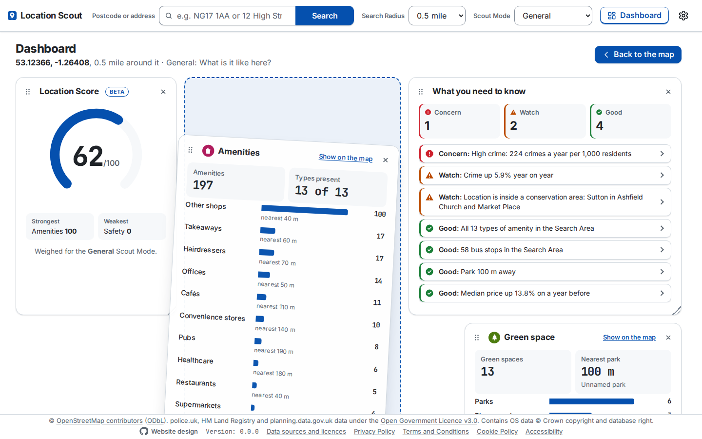

# The Dashboard

The **Dashboard** draws every figure a Search Area has, at full width, in place of the map and the side panel. Open it with the **Dashboard** button in the header, beside Settings. **Back to the map**, the same button pressed again, or the browser's Back closes it. It is a view of its own in the URL, `?…&view=dashboard`, beside the Search Area's own parameters, so a shared or reloaded link opens it again (`apps/web/src/report/report-view.ts`). The header stays, so a new search, Search Radius or Scout Mode redraws the Dashboard in place.

  

## What it shows

It shows only what the Location Overview gives, from the same responses, so it loads nothing more.

- **Location Score:** the one hero figure, in an arc, with the strongest and weakest Category Scores under it. It is weighed as the Overview weighs it, by the Scout Mode or your own weights.
- **Category Scores:** each out of 100 as a bar. A score left out says so, and why.
- **What you need to know:** the Highlights counted by level (Concern, Watch, Good), then each one. Choosing one goes back to the map and points out its Layer.
- **A card for each Layer**, those the Scout Mode highlights first, each marked as the Overview marks them:

| Layer | Figures | Charts |
|---|---|---|
| Crime | Last 12 months with the year-on-year change, the latest month | Each category's 12 months before against the last 12, as a dumbbell |
| Planning | Planning Applications and homes approved or pending | Constraints by type; applications by status (part of a whole) and by type |
| Amenities | Count, types present | Each type, most first, with its nearest |
| Schools | Count, nearest primary and secondary | Latest Ofsted judgements (part of a whole); schools by phase |
| Transport | Nearest railway station, km of footpath and cycle route | Facilities by type |
| Green space | Count, nearest park | Green spaces by type |
| Property | Median price with its 12-month change, the 5-year change | Median price over time, by quarter or year, with a tooltip; median by property type; EPC bands, with `EPC_API_KEY` |
| Land | Land Opportunities, hectares, homes estimated | Ownership Categories, indicative (part of a whole) |
| Demographics | Residents, households, median age | Age profile; household income against England's median; the deprivation deciles |

A card shows its Layer loading, unavailable or not prepared, as the Overview does.

## Moving, resizing and hiding the Widgets

  

Each card is a **Widget** on a 12-column Grid (`apps/web/src/dashboard/widget-layout.ts`, drawn by `WidgetGrid.tsx`). Each Widget covers whole cells and is as tall as its content. The Grid measures the content whenever its size changes. Widgets whose tops are level are drawn as tall as the tallest of them, so each row ends level and leaves no blank space under the shorter ones. The default layout fills every row: the lead's three Widgets across the Grid's 12 columns (3, 4 and 5 wide), then the Layers three to a row (4 wide each).

- **Drag a Widget by its header** (its grip, ⠿, or its title) to move it. It follows the pointer, tilts slightly to the right and lifts above the rest. A dashed placeholder shows where it will land, and the other Widgets move to where they will go. Escape puts it back. Held near the top or bottom of the Dashboard, the pointer scrolls it.
- **Dropped**, it snaps to its cells and settles there. It is pushed onto a Widget above or beside it and pushes that Widget down. Dropped onto the one below it, it swaps with that one. Every Widget then rises as far as it can, so no band of blank space is left. The Widgets it moved, and those it now touches, jump away from it, as if nudged.
- **Drag a Widget's bottom-right corner** to resize it. It snaps to whole cells, no smaller than 3 columns by 6 rows, and pushes down whatever it grows over. Made only wider or narrower, it stays as tall as its content. Made taller or shorter, it keeps that height, and its content scrolls inside it if it doesn't fit. **Double-click the corner** to fit it to its content again.
- **Hide a Widget** with the × in its header. Its rows close up, and what was below it rises. **Settings** (the cog) lists every Widget under **Dashboard Widgets**, saying whether each is shown or hidden. Tick a hidden one to show it again where it was.
- **From the keyboard**, a Widget's grip moves it with the arrow keys, one cell at a time, and resizes it with Shift and the arrow keys. It says where the Widget went, or how big it is now.
- **The layout is kept** in the browser (`location-scout:dashboard-layout`), so the Dashboard opens as it was left: where each Widget is, its size, and whether it is hidden. **Reset layout** goes back to the default, every Widget shown, where the Scout Mode's Layers come first.
- **Narrower than 60rem**, the Grid stacks the Widgets in one column, in the order they are read. They can't be moved or resized there, but they can still be hidden.
- With a reduced-motion preference, nothing tilts or jumps.

`e2e/dashboard.spec.ts` covers the tilt, the placeholder, the nudge, resizing by the corner and the keyboard, hiding and showing again from Settings, keeping and resetting the layout, and that the page itself never scrolls past the footer.

## How it is drawn

Each chart follows the same rules (`apps/web/src/dashboard/charts.tsx`):

- **Bar charts are tables.** Each row is a `<th>` and a `<td>`, and the bar is an `aria-hidden` span in the cell beside its written value, so the chart and its accessible table are one thing. The crime dumbbell is a table too.
- **One series, one hue.** Bars, lines and the gauge are in the theme's accent, which every theme holds to 3:1 or more. Parts of a whole use the colours the map draws them in, each named in a key with its count and share. Ofsted judgements use one blue, light to dark. EPC bands use the certificates' own green-to-red colours.
- **Text is never a data colour.** Values, labels and keys use the theme's text colours. A coloured swatch beside them carries identity.
- **The line chart** has a 2 px line, 4 px dots with a 2 px surface ring, a hairline grid and round ticks. A crosshair and a tooltip follow the pointer. When the chart has keyboard focus, the arrow keys move between points. **Show as a table** gives every point in words.
- While a Layer loads, its card is `aria-busy` and holds three shimmering bars where its figures will be. The shimmer stops with a reduced-motion preference.

The Dashboard is checked with axe in light and dark mode, and checked for no sideways scrolling at 320 px wide (`e2e/main-views.ts`). `e2e/dashboard.spec.ts` covers opening it, deep links, Back and Forward, **Show on the map**, the tooltip and the Scout Mode's order.
